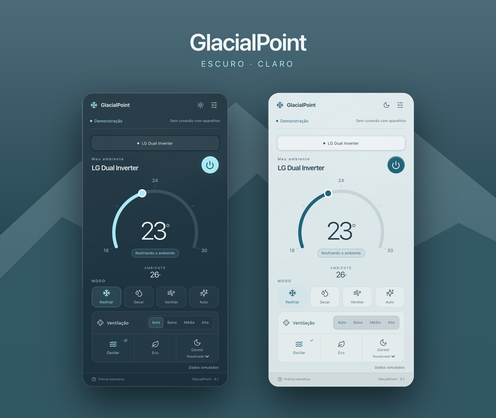
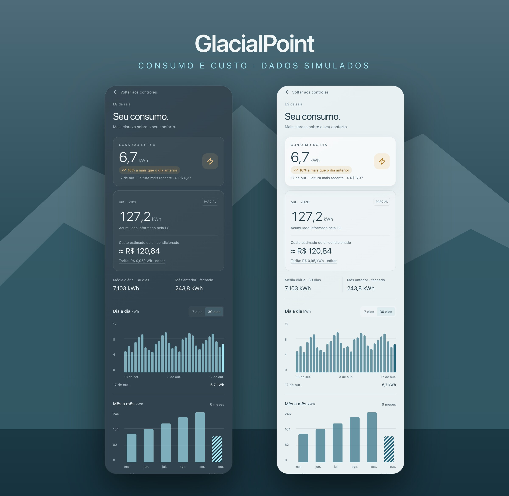

# GlacialPoint

Seu clima, no ponto. Aplicativo desktop independente para controle de ar-condicionado, com interface de vidro inspirada no macOS Tahoe. Windows primeiro; macOS será validado em hardware real depois.

O GlacialPoint conversa direto com as nuvens oficiais de duas linhas de ar-condicionado — **LG ThinQ** (token pessoal, região Brasil) e **Elgin Smart** (plataforma Tuya, via projeto de nuvem próprio). Não há servidor intermediário: leitura e comandos saem deste computador. Stack: Electron + React + TypeScript + Vite + Tailwind, com o processo desktop separado da interface por um preload de API limitada.

<p align="center">
  
</p>

<p align="center"><a href="docs/media/glacialpoint-promo.mp4">Vídeo em alta (MP4, 26 s)</a> · <a href="https://github.com/rildomar/glacialpoint/releases/latest">Baixar a versão mais recente</a></p>

| Temas escuro e claro | Consumo e custo |
|---|---|
|  |  |

Imagens e vídeo gerados a partir da prévia com **dados simulados** — nenhuma conta real aparece. Telas completas: [tema escuro](docs/media/tela-escura.jpg) · [tema claro](docs/media/tela-clara.jpg).

## Estado atual

- **LG ThinQ** — conexão validada com a conta real do usuário (2026-10-17, rota do QR para contas Google); o painel lê o estado ao vivo, recebe **tempo real** pelo push da nuvem (MQTT sobre AWS IoT) e envia os controles anunciados pelo modelo. Guia completo em [`docs/LG.md`](docs/LG.md).
- **Elgin Smart (Tuya)** — plataforma confirmada na prática (2026-10-17); adaptador de núcleo, push em tempo real, estimativa de consumo e interface (conexão, controle e tutorial) implementados e testados. Falta validar um comando pelo aplicativo com o aparelho real e confirmar a faixa prática de temperatura. Investigação completa em [`docs/ELGIN.md`](docs/ELGIN.md).
- **Energia** — histórico LG validado ao vivo (30 dias e seis meses); estimativa do Elgin implementada (o aparelho não mede energia).
- **macOS** — o aplicativo compila e roda no Mac (Elgin validado ao vivo); faltam a validação do LG (conexão, tempo real e Keychain) e o acabamento de bandeja/menu bar, foco e posicionamento.
- **Distribuição** — `npm run dist:win` gera instalador NSIS (`.exe`) e MSI de desenvolvimento; `npm run dist:mac` gera o dmg no macOS. Os dois saem sem assinatura (avisos do sistema no primeiro uso). Uma tag `v*` publica os instaladores em GitHub Releases pelo workflow do repositório.

## O que o aplicativo faz

- **Controle real, por integração**: LG ThinQ e Elgin Smart, com abas LG/Elgin quando as duas contas estão conectadas e seletor de aparelho quando há mais de um (a escolha fica lembrada).
- **Só o que o aparelho anuncia**: cada controle aparece conforme as capacidades lidas do modelo; dado ausente é "não informado" — nunca zero presumido.
- **Comandos disciplinados**: um por vez, sem alteração otimista e sem repetir POST ambíguo; depois do envio, uma leitura confirma o novo estado.
- **Mostrador circular**: cada aparelho ganha um arco com a escala de temperatura do modelo, e o próprio arco é o seletor — arrastar escolhe a temperatura desejada (o comando só sai ao soltar o clique; as setas do teclado também ajustam). O valor selecionado fica no centro e a leitura do ambiente logo abaixo.
- **Tempo real**: LG e Elgin recebem atualizações empurradas pela nuvem (~1 s, inclusive mudanças feitas por fora, no celular ou no controle físico), com selo de estado no painel; o polling fica como rede de segurança — 20 s com o painel visível, 5 min oculto, após erro ou quando o tempo real já provou o canal, com pausa na suspensão. Abrir o painel força uma consulta na hora quando a última leitura tem mais de 10 s.
- **Consumo e custo**: tela de energia por integração (histórico ThinQ no LG; estimativa por tempo ligado no Elgin), tarifa em R$/kWh e custo mensal estimado.
- **Tutoriais dentro do aplicativo**: "Como conectar" para as duas integrações, com passo a passo ilustrado e botões que abrem os portais oficiais.
- **Painel de bandeja (Windows)**: abre junto à bandeja, oculta ao perder foco, ao pressionar Escape ou ao fechar; arraste pelo cabeçalho e a posição fica guardada entre aberturas.
- **Conforto**: temas claro/escuro, respeito a "Reduzir movimento" do sistema e ajuste para telas pequenas.
- **Sugestão de integração**: registra um rascunho local; o canal de envio será definido antes de habilitar pedidos.

## Conectar as contas

Os passos completos estão no próprio aplicativo — botão **"Como conectar"** nos painéis de boas-vindas, ou **Configurações → integração → Passo a passo de conexão**. Resumo:

**LG ThinQ** — cadastre o ar no aplicativo LG ThinQ (mesma conta que vai gerar o token); gere um token pessoal em <https://connect-pat.lgthinq.com/> (contas via Google entram pela rota do QR com a câmera do celular); cole em **Configurações → LG ThinQ**. Detalhes, renovação e problemas comuns em [`docs/LG.md`](docs/LG.md).

**Elgin Smart** — o vínculo funciona com o app **Smart Life** (repareie o Wi-Fi se necessário: tecla IONAIR 8×); crie um projeto **Cloud** gratuito na plataforma Tuya IoT (datacenter da conta — no Brasil, Western America), ative os serviços Smart Home Basic Service e Device Status Notification e vincule a conta em Devices → Link App Account; cole Access ID e Secret em **Configurações → Elgin Smart**. Investigação e detalhes em [`docs/ELGIN.md`](docs/ELGIN.md).

## Segurança das credenciais

- O token LG e o Access ID/Secret do Elgin nunca ficam na interface: são digitados em campos protegidos, entregues por IPC ao processo principal e guardados criptografados pelo sistema (Electron safeStorage/DPAPI) em `lg-credential.bin` e `elgin-credential.bin`, na pasta de dados do aplicativo. Sem fallback em texto puro.
- Nada de segredo em código, logs, testes, screenshots ou no repositório; fixtures de teste são anonimizadas e respostas reais nunca entram no repositório.
- Desconectar apaga a cópia local; para revogar na origem, apague o token no portal da LG ou gere credenciais novas no projeto Tuya.
- O cofre do sistema não protege contra outros programas rodando sob a mesma conta do Windows.

## Rodar o projeto

Requisitos: Node.js 26+ e npm (Windows para o aplicativo desktop; os testes de interface usam o Microsoft Edge instalado). Esta versão não usa Rust nem módulos nativos próprios; o Electron traz o Chromium, sem depender do WebView2 do sistema.

```sh
npm ci          # instalar
npm run dev     # prévia no navegador — http://127.0.0.1:1420
npm run build   # typecheck (src + electron) + build da interface + bundle do desktop
```

A prévia é uma demonstração sem credenciais: aparelho LG simulado, explicitamente identificado, e preferências de demonstração em memória; o seletor mostra só o demonstrativo e o Elgin aparece nas configurações. A caixa de sugestões salva um rascunho no armazenamento local e não envia pedidos.

```sh
npm run desktop:dev     # Electron em desenvolvimento (Vite na 1421)
npm run desktop:start   # build + Electron com a interface compilada
npm run package:win     # pasta executável em release/win-unpacked (manter a pasta completa)
npm run dist:win        # instaladores NSIS (.exe) e MSI em release/ (sem assinatura)
npm run dist:mac        # dmg no macOS — rodar no próprio Mac (o .dmg só é criado lá)
```

## Gerar uma release

- **Windows**: `npm run dist:win` → `release/GlacialPoint-0.1.1-setup.exe` (NSIS) e `release/GlacialPoint-0.1.1.msi`.
- **macOS**: `npm run dist:mac` no Mac → `release/GlacialPoint-0.1.1-arm64.dmg` (o `.app` vai dentro do dmg). Na release publicada, o workflow renomeia para `-apple-silicon.dmg` e `-intel.dmg`.
- **Publicação automática**: crie a tag igual à versão do `package.json` (`v0.1.1`) e envie; o workflow `.github/workflows/release.yml` compila Windows e macOS (Apple Silicon e Intel) e anexa tudo em **Releases**. Um disparo manual (`workflow_dispatch`) só gera os artefatos do run.
- **Versão atual**: [v0.1.1](https://github.com/rildomar/glacialpoint/releases/latest) — `GlacialPoint-0.1.1-setup.exe`, `GlacialPoint-0.1.1.msi`, `GlacialPoint-0.1.1-apple-silicon.dmg` e `GlacialPoint-0.1.1-intel.dmg`.
- **Sem assinatura**: o Windows mostra "Fornecedor desconhecido" (Mais informações → Executar assim mesmo) e o macOS bloqueia o primeiro clique — use botão direito → **Abrir**. Assinatura/notarização ficam para uma etapa futura.

Mudanças no processo Electron/preload exigem reiniciar o `desktop:dev`. O aplicativo permite uma instância por perfil. Inicie por um terminal comum do Windows: apps empacotados (MSIX) virtualizam o `%APPDATA%` e as credenciais salvas não aparecem em execuções normais.

## Testes

| Comando | O que cobre |
|---|---|
| `npm run test:e2e` | Interface no navegador (Playwright + Edge): **17 casos** — prévia, formulários de conexão, controles por capacidade, energia, alternância de integrações e tutoriais |
| `npm run test:lg` | Núcleo LG (node): **23 casos** — token, descoberta, perfil/estado, comandos, canal de tempo real (rota, certificado, assinaturas e renovação), energia e tarifa |
| `npm run test:elgin` | Núcleo Elgin (node): **32 casos** — fixtures, comandos estritos, assinatura, paginação, sessão, push em tempo real e estimativa de consumo |
| `npm run test:desktop` | Electron compilado: bridge, IPC, isolamento da interface, bloqueio de novas janelas, fechamento para a bandeja, área de arrasto e memória de posição |

O teste desktop usa um perfil temporário separado. `npm run build` limpo é esperado antes de qualquer commit.

## Energia e tarifa

A tela de consumo (ícone de gráfico) segue a integração e o aparelho dos controles — e permite trocar a seleção no topo quando há mais de uma opção. O dia mais recente fechado aparece em destaque ("consumo do dia"), com selo de tendência em relação ao anterior quando há leitura; as estatísticas trazem a média diária de 30 dias.

- **LG — histórico real**: perfil de energia e histórico ThinQ de 30 dias completos mais seis meses (incluindo o atual), no calendário de America/Sao_Paulo. Valores em Wh são convertidos para kWh; ausências ficam como sem leitura (zero real continua zero) e o mês atual é parcial.
- **Elgin — estimativa**: o aparelho não reporta consumo, então o aplicativo estima por tempo ligado (logs do canal `switch`, janela de 7 dias) vezes um consumo médio configurável (padrão 0,7 kWh/h), com acumulado diário que sobrevive a dias sem abrir a tela. O painel marca **ESTIMATIVA** e explica o cálculo.
- **Tarifa**: Configurações → Energia (ou atalho no resumo de consumo) salva a tarifa em R$/kWh no `energy-settings.json`. O custo estimado usa a tarifa atual vezes o consumo do mês; campo vazio remove a estimativa; sem cobranças fixas nem histórico de tarifas. A tarifa não é enviada a nenhuma nuvem.
- Resultados ficam em cache por até cinco minutos e são descartados ao trocar sessão/aparelho.
- Validação: consultas reais de 30 dias e seis meses responderam com leituras para o LG conectado; nenhum comando de controle foi enviado nessa verificação.

## Arquitetura

- `src/` — interface React (painéis LG/Elgin, energia, configurações, tutoriais) e dados simulados da prévia, sempre identificados como tais.
- `electron/` — processo desktop: `main.ts` (janela, bandeja, IPC, posição da janela), `preload.ts` (API mínima) e stores (credenciais, tarifa, estimativa de consumo, posição da janela).
- `electron/core/` — integrações e regras independentes da interface: cliente/sessão/push LG e Elgin, energia e validação de comandos.
- `shared/` — contratos TypeScript compartilhados entre interface e processo principal; mudança aqui atualiza os dois lados juntos.
- `tests/` — Playwright (prévia) e testes de núcleo (node), com fixtures anonimizadas.
- `scripts/` — build do desktop, testes de núcleo/desktop e sondas da API Tuya (`tuya-probe`, `tuya-control`, `tuya-pulsar`, `tuya-energy`).
- `docs/` — [`LG.md`](docs/LG.md), [`ELGIN.md`](docs/ELGIN.md), [`ROADMAP.md`](docs/ROADMAP.md) e `media/` (vídeo, imagens e texto de divulgação).
- A interface só fala com o processo principal pelo preload; credenciais nunca cruzam essa ponte. Os efeitos de vidro são CSS sobre uma paisagem gerada em CSS — não é uma implementação nativa de Liquid Glass; materiais nativos do macOS ficam para o marco E.

## Origem e licenças

O Celsius de Gabriel Villarinho é a referência da integração LG portada para TypeScript. Base examinada: `1bb0c66d137a13defbb3f6b41d82cfd4a02b23cb`, também presente no fork [rildomar/celsius](https://github.com/rildomar/celsius). Cliente, modelos e payloads foram adaptados; fixtures de perfil e estado foram reaproveitadas com atribuição. Consulte [`THIRD_PARTY_NOTICES.md`](THIRD_PARTY_NOTICES.md) e `licenses/Celsius-MIT.txt`. O projeto é licenciado sob MIT (`LICENSE`).
